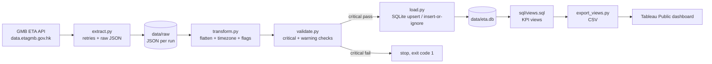

# HK Green Minibus ETA Data Pipeline

An end-to-end ETL pipeline that collects real-time arrival estimation (ETA) data for Hong Kong green minibus route **11M** (Tseung Kwan O area), validates and stores it in SQLite, and publishes a KPI dashboard on Tableau Public.

**Live dashboard:** [https://public.tableau.com:9443/views/Minibus11METAPipeline/Dashboard1?:language=en-US&publish=yes&:sid=&:redirect=auth&:display_count=n&:origin=viz_share_link]
**Data as of:** [24/11/2026] | **Collected:** 371 pipeline runs, 10507 ETA rows over 7 days


## Why this project

Being one of the students who relies on 11M transportation to go to HKUST, the minibus arrival time often felt unreliable and fluctuating. Hence the motivation for collecting data to analyse the estimated time of arrival and the average wait time to try to understand how the minibus line behave generally.
Real-time ETA data can't be re-fetched once the moment has passed, so the pipeline has to collect it reliably over time. This project covers the full data workflow: extract from a public API, clean and transform, validate, load into a database with idempotent writes, schedule the collection, and report KPIs through a dashboard.

## Data flow



`run_pipeline.py` chains extract, transform, validate and load. Windows Task Scheduler runs it every 10 minutes during collection hours.

## Data source

- Transport Department, "Real-time arrival data of green minibuses (GMBs)" on [data.gov.hk](https://data.gov.hk).
- API base URL: `https://data.etagmb.gov.hk` ([specification](https://data.etagmb.gov.hk/static/GMB_ETA_API_Specification.pdf)).
- Target: route 11M (`route_id` 2004825), both directions (3 stops in direction 1, 7 in direction 2).
- ETA updates about once a minute, with up to 3 upcoming minibuses per stop. A `remarks_en` value of "Scheduled" means a timetable estimate, "Delayed" means traffic delay, and blank means a live GPS estimate.

## Repository layout

```
src/
  config.py          # project-root based paths (works from any working directory)
  extract.py         # API calls, retry with exponential backoff, save raw JSON
  transform.py       # flatten JSON, convert to Asia/Hong_Kong time, derive flags
  validate.py        # data-quality checks (critical vs warning)
  load.py            # SQLite schema, idempotent load, validation log
  run_pipeline.py    # orchestrates the full run
  export_views.py    # exports SQL views to CSV for Tableau
sql/
  views.sql          # KPI views
environment.yml
```

## Database schema (SQLite)

| Table | Purpose | Key |
|---|---|---|
| `fact_eta` | One row per ETA entry (or one `no_eta` row per poll) | UNIQUE (route_id, route_seq, stop_seq, fetched_at, eta_seq) |
| `dim_stop` | Stop names (EN/TC/SC) per route, direction and stop sequence | PK (route_id, route_seq, stop_seq) |
| `validation_log` | Result of every data-quality check per loaded file | none |
| `processed_files` | Raw files already loaded | PK filename |

Design notes:
- `stop_id` is not unique within a route (the same stop can appear in both directions), so stops are keyed on (route_id, route_seq, stop_seq).
- Loading is **idempotent**: already-loaded files are skipped and fact rows use `INSERT OR IGNORE`. The true inserted count is measured with `conn.total_changes`.
- `dim_stop` uses an upsert with `COALESCE`, so a later file with missing names cannot overwrite good names.
- Raw JSON is kept for every run, because the source data cannot be re-fetched.

## Data-quality checks

| Check | Level | What it tests |
|---|---|---|
| `empty_test` | critical | DataFrame is not empty |
| `required_columns` | critical | Key columns exist |
| `null_key` | critical | No nulls in route/stop keys |
| `status_valid` | critical | Status is `ok`, `no_eta` or `disabled` |
| `wait_time` | warning | ETA wait is between 0 and 120 minutes |
| `no_future_timestamps` | warning | No fetch time later than now |

A critical failure stops the load and exits with a non-zero code. Every result is written to `validation_log`.

## KPIs (dashboard)

- Average wait by hour of day
- Share of live vs scheduled vs delayed estimates
- No-service share by hour
- Average wait by stop and direction
- Data freshness (last fetch, total rows, runs loaded)
- Validation pass rate per check

Caveat: average wait mixes live GPS estimates with timetable estimates, so read it together with the live/scheduled share. Hours with few observations are noisy.

## Setup

```bash
conda env create -f environment.yml
conda activate minibus-eta-pipeline
```

Run one full cycle from the project root:

```bash
python src/run_pipeline.py
```

Refresh the dashboard data:

```bash
python src/export_views.py
```

Then refresh the data sources in Tableau Public Desktop and re-publish.

### Scheduling (Windows Task Scheduler)

- Program: full path to the environment's `python.exe`
- Arguments: `src\run_pipeline.py`
- Start in: the project root folder
- Trigger: daily from 07:00, repeat every 10 minutes
- Settings: do not start a new instance if already running


## Limitations

- Collection runs on a personal laptop, so runs can be missed when it sleeps or is offline. Gaps are visible in the data.
- The dashboard is a snapshot published to Tableau Public and is refreshed manually.
- Only one route is collected. The code is parameterised by `TARGET_ROUTE_ID`, so adding routes is a small change.
- Test coverage is not yet in place. Data quality is enforced at runtime by the validation checks.

## Possible next steps

- Unit tests for `flatten` and the validation checks.
- Weather join (HKO rainfall) to see whether rain affects wait times.
- Stop coordinates from the `/stop/{stop_id}` endpoint for a map view.
- Move scheduling to a cloud runner so collection does not depend on a laptop.

## Data and licence

Source data is provided by the Hong Kong Transport Department via data.gov.hk. Check the dataset's terms of use before redistributing data.
