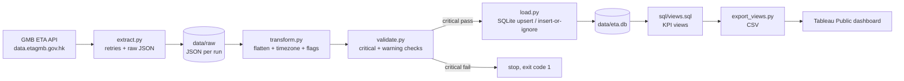

# HK Green Minibus ETA Data Pipeline

An end-to-end ETL pipeline that collects real-time arrival estimation (ETA) data for Hong Kong green minibus route **11M** (Tseung Kwan O area), validates and stores it in SQLite, and publishes a KPI dashboard on Tableau Public.

**Live dashboard:** (https://public.tableau.com/views/Minibus11METAPipeline/Dashboard1)
**Data as of:** 2026-11-24 | **Collected:** 371 pipeline runs, 10,507 ETA rows over 7 days


## Why this project

How long do passengers wait for 11M at different times of the day? A single ride tells you little about typical wait times, so I collected ETA data over time to measure how waits vary by hour and stop.
Real-time ETA data can't be re-fetched once the moment has passed, so the pipeline has to collect it reliably over time. This project covers the full data workflow: extract from a public API, clean and transform, validate, load into a database with idempotent writes, schedule the collection, and report KPIs through a dashboard.

## Data flow



`run_pipeline.py` chains extract, transform, validate and load. Windows Task Scheduler runs it every 10 minutes during collection hours.

## Data source

- Transport Department, "Real-time arrival data of green minibuses (GMBs)" on [data.gov.hk](https://data.gov.hk).
- API base URL: `https://data.etagmb.gov.hk` ([specification](https://data.etagmb.gov.hk/static/GMB_ETA_API_Specification.pdf)).
- Target: route 11M (`route_id` 2004825), both directions (3 stops in direction 1, 7 in direction 2).
- ETA updates about once a minute, with up to 3 upcoming minibuses per stop. A `remarks_en` value of "Scheduled" means a timetable estimate, "Delayed" means traffic delay, and blank means a live GPS estimate.

## Repository layout

```
src/
  config.py          # project-root based paths (works from any working directory)
  extract.py         # API calls, retry with exponential backoff, save raw JSON
  transform.py       # flatten JSON, convert to Asia/Hong_Kong time, derive flags
  validate.py        # data-quality checks (critical vs warning)
  load.py            # SQLite schema, idempotent load, validation log
  run_pipeline.py    # orchestrates the full run
  export_views.py    # exports SQL views to CSV for Tableau
sql/
  views.sql          # KPI views
environment.yml
```

## Database schema (SQLite)

| Table | Purpose | Key |
|---|---|---|
| `fact_eta` | One row per ETA entry (or one `no_eta` row per stop per poll) | UNIQUE (route_id, route_seq, stop_seq, fetched_at, eta_seq) |
| `dim_stop` | Stop names (EN/TC/SC) per route, direction and stop sequence | PK (route_id, route_seq, stop_seq) |
| `validation_log` | Result of every critically passed data-quality check per loaded file | none |
| `processed_files` | Raw files already loaded | PK filename |

Design notes:
- `stop_id` is not unique within a route (the same stop can appear in both directions), so stops are keyed on (route_id, route_seq, stop_seq).
- Loading is **idempotent**: already-loaded files are skipped and fact rows use `INSERT OR IGNORE`. The true inserted count is measured with `conn.total_changes`.
- `dim_stop` uses an upsert with `COALESCE`, so a later file with missing names cannot overwrite good names.
- Raw JSON is kept for every run, because the source data cannot be re-fetched.

## Data-quality checks

| Check | Level | What it tests |
|---|---|---|
| `empty_test` | critical | DataFrame is not empty |
| `required_columns` | critical | Key columns exist |
| `null_key` | critical | No nulls in route/stop keys |
| `status_valid` | critical | Status is `ok`, `no_eta` or `disabled` |
| `wait_time` | warning | ETA wait is between 0 and 120 minutes |
| `no_future_timestamps` | warning | No fetch time later than now |

A critical failure stops the load and exits with a non-zero code. Every result is written to `validation_log`.

## KPIs (dashboard)

- Average wait by hour of day
- No-service share by hour
- Average wait by stop and direction
- Data freshness (last fetch, total rows, runs loaded)
- Validation pass rate per check

Caveat: some average wait times are timetable estimates.

## Setup

```bash
conda env create -f environment.yml
conda activate minibus-eta-pipeline
```

Run one full cycle from the project root:

```bash
python src/run_pipeline.py
```
The first run creates data/ and the SQLite database.
Refresh the dashboard data:

```bash
python src/export_views.py
```

Then refresh the data sources in Tableau Public Desktop and re-publish.

### Scheduling (Windows Task Scheduler)

- Program: full path to the environment's `python.exe`
- Arguments: `src\run_pipeline.py`
- Start in: the project root folder
- Trigger: daily from 06:00, repeat every 10 minutes until 24:00
- Settings: do not start a new instance if already running


## Limitations

- Collection runs on a personal laptop, so runs can be missed when it sleeps or is offline. Gaps are visible in the data, that is roughly 60% of the theoretical amount of data were collected during the day.
- The dashboard is a snapshot published to Tableau Public and is refreshed manually.
- Only one route is collected. The code is parameterised by `TARGET_ROUTE_ID`, so adding routes is a small change.
- Test coverage is not yet in place. Data quality is enforced at runtime by the validation checks.

## Findings

- Hours with the longest average wait is 06:00 and 23:00 with average wait time of 20.6 and 13.1 minutes respectively.
- Service hours spans from 06:00 to 24:00.
- Stations with the longest average wait time is Hong Kong University of Science and Technology (North Station) for direction 1, and Hang Hau Station Public Transport Interchange for direction 2, the last stop of both routes respectively.

## Possible next steps

- Unit tests for `flatten` and the validation checks.
- Weather join (HKO rainfall) to see whether rain affects wait times.
- Stop coordinates from the `/stop/{stop_id}` endpoint for a map view.
- Move scheduling to a cloud runner so collection does not depend on a laptop.

## Data and licence

**Code:** [MIT License](LICENSE).

**Data:** Real-time arrival data of green minibuses (GMBs), provided by the
Transport Department of the Hong Kong SAR Government via
[DATA.GOV.HK](https://data.gov.hk/en-data/dataset/hk-td-sm_7-real-time-arrival-data-of-gmb).
The data is free to re-use under the
[DATA.GOV.HK Terms and Conditions of Use](https://data.gov.hk/en/terms-and-conditions),
which require clear attribution of the source. The Government and the
relevant organisations own the intellectual property in the data, and the
data is provided "as is". This repository does not claim ownership of the
data. The MIT licence applies to the code only.
